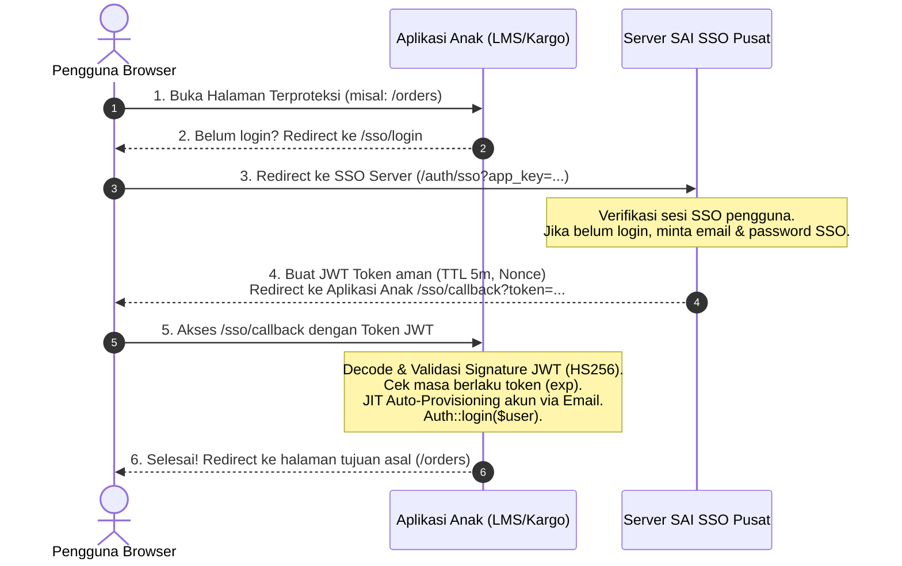

# 🚀 SAI & uKurir SSO Client SDK for Laravel

[](https://github.com/drymhd/sso-client-ukurir/releases)
[](LICENSE)
[](https://php.net)
[](https://laravel.com)

SDK Client resmi Laravel untuk mengintegrasikan aplikasi anak (**LMS, Sistem Kargo, Finansial, Operasional, dll.**) secara instan ke portal pusat **SAI SSO (Single Sign-On)** ekosistem PT Sumber Alfaria Trijaya & uKurir.

---

## 📋 Daftar Isi
1. [Arsitektur & Alur Kerja](#-arsitektur--alur-kerja)
2. [Fitur Unggulan](#-fitur-unggulan)
3. [Panduan Instalasi Cepat](#-panduan-instalasi-cepat)
4. [Konfigurasi Environment (.env)](#-konfigurasi-environment-env)
5. [Contoh Penggunaan Praktis](#-contoh-penggunaan-praktis)
   - [A. Memproteksi Rute (Silent Login)](#a-memproteksi-rute-silent-login)
   - [B. Tombol Login Manual](#b-tombol-login-manual)
   - [C. Mengambil Data Pengguna & Token SSO](#c-mengambil-data-pengguna--token-sso)
   - [D. Logout Terpadu](#d-logout-terpadu)
6. [Mekanisme JIT (Just-In-Time) Auto-Provisioning](#-mekanisme-jit-just-in-time-auto-provisioning)
7. [Spesifikasi Keamanan Token](#-spesifikasi-keamanan-token)
8. [Troubleshooting & Tanya Jawab (FAQ)](#-troubleshooting--tanya-jawab-faq)

---

## 🏛️ Arsitektur & Alur Kerja



---

## ✨ Fitur Unggulan

- **⚡ Zero Configuration Setup**: Cukup jalankan satu perintah `php artisan sso:install`.
- **🔄 Auto-Discovery**: Terdaftar otomatis di Laravel 10 dan Laravel 11 tanpa perlu edit `config/app.php`.
- **👤 Just-In-Time (JIT) Auto-Provisioning**: Pengguna baru otomatis dibuatkan akun di database aplikasi anak berdasarkan email SSO. **Admin tidak perlu lagi menginput `ref_user_id` manual satu per satu di dashboard.**
- **🛡️ Siklus Hidup Token Aman**: Validasi otomatis batas kedaluwarsa JWT (`exp: 5m`), nonce unik anti-*replay attack* (`jti`), serta verifikasi *issuer* dan *audience*.
- **🚪 Seamless Silent Login**: Pengguna yang sudah login di SSO akan langsung masuk ke aplikasi anak tanpa melihat form login.
- **🎯 Intended URL Memory**: Setelah otentikasi SSO selesai, pengguna otomatis dikembalikan ke URL halaman yang awalnya ingin mereka buka.

---

## 📥 Panduan Instalasi Cepat

### Langkah 1: Daftarkan Repository di `composer.json` Aplikasi Anak

Buka file `composer.json` di proyek aplikasi anak, lalu tambahkan blok `repositories`:

```json
"repositories": [
    {
        "type": "vcs",
        "url": "https://github.com/drymhd/sso-client-ukurir.git"
    }
]
```

### Langkah 2: Install Package via Composer

Jalankan perintah berikut di terminal:

```bash
composer require drymhd/sso-client-ukurir
```
*(Catatan: Anda juga bisa menggunakan alias `composer require saitrans/sso-client`)*

---

### Langkah 3: Jalankan Instalasi Interaktif

Jalankan perintah wizard di terminal proyek anak:

```bash
php artisan sso:install
```

Wizard akan menanyakan beberapa konfigurasi penting:
1. **URL SSO Server**: `https://sso.saitrans.id` (atau `http://localhost:8000` di lokal).
2. **SSO App Key**: Kunci aplikasi yang didapatkan dari dashboard admin SSO (contoh: `app_6745abc...`).
3. **OAuth Client Secret**: Secret key yang terdaftar di master data OAuth Client SSO.
4. **Nama Rute Tujuan**: Rute default setelah login berhasil (contoh: `home` atau `dashboard`).

File `config/sso-client.php` dan file `.env` Anda akan diperbarui secara otomatis!

---

## ⚙️ Konfigurasi Environment (`.env`)

Berikut adalah variabel `.env` yang dapat Anda sesuaikan kapan saja:

| Variabel | Tipe | Default | Deskripsi |
| :--- | :---: | :---: | :--- |
| `SSO_SERVER_URL` | String | `http://localhost:8000` | URL domain server SSO pusat |
| `SSO_APP_KEY` | String | *(Wajib)* | Kunci unik modul aplikasi Anda di SSO |
| `SSO_CLIENT_SECRET` | String | *(Wajib)* | Secret key OAuth untuk memvalidasi JWT |
| `SSO_REDIRECT_ROUTE` | String | `home` | Nama rute tujuan setelah login berhasil (Web Monolith) |
| `SSO_FRONTEND_URL` | String | `null` | URL redirect frontend SPA Vue/React (contoh: `http://localhost:5173/auth/callback`) |
| `SSO_AUTO_PROVISION` | Boolean | `true` | Otomatis buat user baru jika email belum ada (mendukung UUID) |
| `SSO_USER_MODEL` | Class | `null` (Auto) | Model User. Jika null, otomatis membaca `config('auth.providers.users.model')` |

---

## 🛠️ Contoh Penggunaan Praktis

### A. Memproteksi Rute (Silent Login)
Pasang middleware `sso.auth` pada rute atau grup rute yang mewajibkan otentikasi SSO:

```php
// routes/web.php di aplikasi anak
Route::middleware(['sso.auth'])->group(function () {
    Route::get('/dashboard', [DashboardController::class, 'index'])->name('dashboard');
    Route::get('/orders', [OrderController::class, 'index'])->name('orders');
    Route::get('/profile', [ProfileController::class, 'index'])->name('profile');
});
```
*Jika pengguna yang belum login membuka `/orders`, sistem akan mengarahkannya ke SSO, memvalidasi sesi, lalu otomatis mengembalikannya tepat ke halaman `/orders`.*

---

### B. Tombol Login Manual
Jika Anda ingin menyertakan tombol masuk manual di halaman landing page / login bawaan:

```html
<!-- resources/views/auth/login.blade.php -->
<a href="{{ route('sso.login') }}" class="btn btn-primary d-inline-flex align-items-center gap-2">
    <i class="bi bi-shield-lock-fill"></i>
    <span>Masuk dengan Akun SSO Perusahaan</span>
</a>
```

---

### C. Mengambil Data Pengguna & Token SSO
Gunakan Facade `SSO` di Controller atau Blade View untuk membaca data sesi SSO:

```php
namespace App\Http\Controllers;

use Illuminate\Http\Request;
use Saitrans\SsoClient\Facades\SSO;

class DashboardController extends Controller
{
    public function index()
    {
        // 1. Profil Pengguna dari SSO Server
        $ssoUser = SSO::user();
        /*
        Contoh isi array $ssoUser:
        [
            'id'    => 12,
            'name'  => 'Budi Santoso',
            'email' => 'budi@saitrans.id',
            'level' => 'admin'
        ]
        */

        // 2. Passport Bearer Access Token (jika aplikasi anak perlu memanggil API SSO)
        $token = SSO::token();

        // 3. User Eloquent lokal aplikasi anak (standar Laravel)
        $localUser = auth()->user();

        return view('dashboard', compact('ssoUser', 'localUser'));
    }
}
```

---

### D. Logout Terpadu
Package secara otomatis menyediakan rute `/sso/logout`:

```html
<!-- Link Logout di Navbar / Sidebar -->
<a href="{{ route('sso.logout') }}" class="text-danger">
    <i class="bi bi-box-arrow-right"></i> Keluar (Logout)
</a>
```

---

### E. Integrasi Frontend SPA (Vue 3 / React / Vite) & REST API

Jika aplikasi anak memiliki frontend terpisah (misalnya Vue 3 di port 5173 atau aplikasi mobile):

1. **Konfigurasi `.env`**:
   ```env
   SSO_FRONTEND_URL=http://localhost:5173/auth/callback
   ```

2. **Alur Otomatis**:
   - Pengguna dialihkan ke SSO pusat untuk otentikasi.
   - Setelah validasi berhasil di backend Laravel, endpoint `/sso/callback` otomatis me-redirect browser ke:
     ```
     http://localhost:5173/auth/callback?token={BEARER_TOKEN}
     ```
   - Komponen Vue (seperti `SsoCallback.vue`) tinggal mengambil query parameter `token`, menyimpannya ke `localStorage` / Pinia store, dan melakukan redirect ke Dashboard!

3. **Request Langsung via REST API (Axios / Postman / Mobile App)**:
   Jika request dikirim dengan header `Accept: application/json` ke `/sso/callback?token=...`, controller otomatis mengembalikan response JSON:
   ```json
   {
       "success": true,
       "message": "Berhasil login melalui Single Sign-On (SSO).",
       "user": {
           "id": "287a15a9-de01-484e-b33c-224a71776cc9",
           "name": "Budi Santoso",
           "email": "budi@saitrans.id"
       },
       "access_token": "eyJ0eXAiOiJKV1QiLCJhbGciOiJSUzI1Ni..."
   }
   ```

---

## 👤 Mekanisme JIT (Just-In-Time) Auto-Provisioning

Salah satu keunggulan utama versi 3.0 adalah **Admin SSO tidak perlu lagi menginput ID user aplikasi anak (`ref_user_id`) secara manual.**

### Bagaimana Cara Kerjanya?
1. Saat user mengklik aplikasi di launcher SSO, server SSO mengirimkan payload berisi:
   ```json
   {
       "user": {
           "name": "Budi Santoso",
           "email": "budi@saitrans.id",
           "level": "user"
       }
   }
   ```
2. SDK di aplikasi anak menerima payload dan memeriksa tabel `users` lokal:
   - **Kasus A: Email Sudah Ada**: User langsung di-*link* dan login ke akun tersebut. Jika nama di SSO diperbarui, nama di aplikasi anak ikut disinkronisasi otomatis.
   - **Kasus B: Email Belum Ada**: Jika `SSO_AUTO_PROVISION=true`, SDK otomatis mengeksekusi:
     ```php
     User::create([
         'name'     => $ssoUser['name'],
         'email'    => $ssoUser['email'],
         'password' => Hash::make(Str::random(32)), // Password acak aman
     ]);
     ```
     Akun langsung dibuat dan pengguna langsung masuk tanpa hambatan.

---

## 🔒 Spesifikasi Keamanan Token

Token SSO dirancang dengan standar keamanan enterprise:
- **Algoritma**: `HS256` (HMAC SHA-256) menggunakan secret key unik per aplikasi.
- **Masa Berlaku Ketat (`exp`)**: Dibatasi hanya **5 menit (300 detik)**. Mencegah token yang tertinggal di browser history disalahgunakan.
- **Anti-Replay Nonce (`jti`)**: Setiap token memiliki UUID unik 32 karakter.
- **Verifikasi Asal (`iss`) & Target (`aud`)**: Memastikan token hanya dapat dikonsumsi oleh aplikasi pemilik App Key yang sah.

---

## ❓ Troubleshooting & Tanya Jawab (FAQ)

#### Q: Mengapa muncul error `Validasi Token SSO Gagal: Signature verification failed`?
> **Jawab:** Pastikan `SSO_CLIENT_SECRET` pada file `.env` aplikasi anak **sama persis** dengan `Secret` yang tertera pada menu **Master Data > OAuth 2.0 Clients** di dashboard SSO pusat.

#### Q: Mengapa muncul error `Sesi Token SSO telah kedaluwarsa`?
> **Jawab:** Token SSO memiliki TTL 5 menit. Error ini biasanya terjadi jika waktu jam (NTP time) di server SSO dan server aplikasi anak berselisih lebih dari 5 menit. Pastikan kedua server mengaktifkan sinkronisasi waktu NTP.

#### Q: Bagaimana jika tabel User aplikasi anak memiliki kolom tambahan yang `required`?
> **Jawab:** Anda dapat mengaitkan *event listener* pada model User atau menonaktifkan `SSO_AUTO_PROVISION=false` dan membuat *custom resolver* di controller Anda sendiri.

---

## 📄 Lisensi
Hak Cipta © PT Sumber Alfaria Trijaya & uKurir Ecosystem.  
Didistribusikan di bawah lisensi resmi [MIT](LICENSE).
